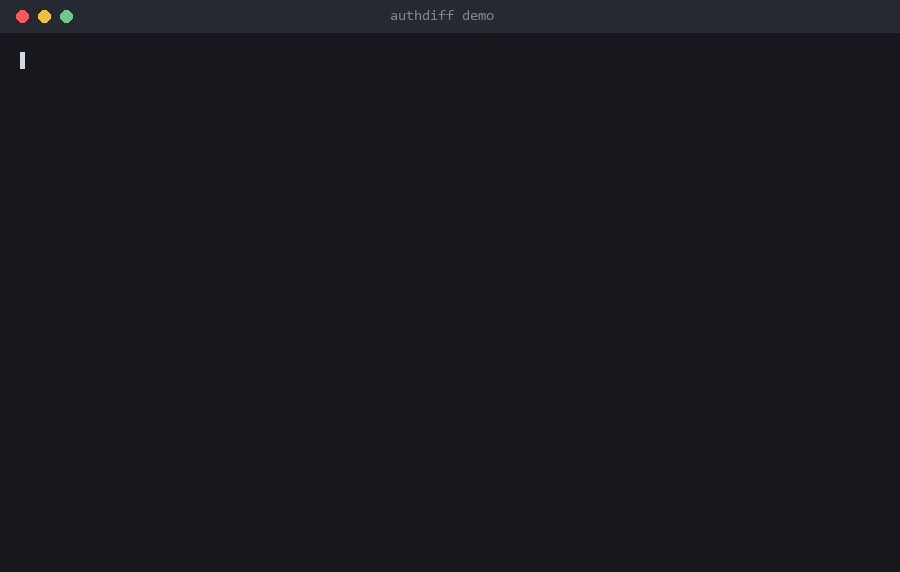

# authdiff

[](https://github.com/ardayesilcayir/authdiff/actions/workflows/ci.yml)
[](https://github.com/ardayesilcayir/authdiff/actions/workflows/e2e.yml)
[](https://github.com/ardayesilcayir/authdiff/actions/workflows/codeql.yml)
[](LICENSE)

**authdiff, REST API'lerdeki yetkilendirme açıklarını bulur**: nesne düzeyinde
yetki ihlali (BOLA/IDOR), fonksiyon düzeyinde yetki ihlali (BFLA), kimlik
doğrulamasız erişim ve mass assignment. OpenAPI dosyanızı ve birkaç kimliği
(admin, iki kullanıcı, anonim) verirsiniz; authdiff her endpoint'i her
kimlikle çağırır, yanıtları karşılaştırır ve kimin erişmemesi gereken veriye
eriştiğini maskelenmiş istek/yanıt kanıtıyla terminal, JSON, SARIF ve HTML
olarak raporlar.

[English README](README.en.md)



## Neden

Yetki açığının bir "imzası" yoktur: `GET /orders/42` tamamen geçerli bir
istektir; yalnızca isteği yapan kullanıcı 42 numaralı siparişin sahibi
değilse hatalıdır. Genel tarayıcılar tek oturumla çalışır ve "A bunu
görebiliyor, B görebilmeli mi?" sorusunu sormaz. Proxy eklentileri bu soruyu
elle yanıtlar ve CI'da çalışmaz. authdiff bunu OpenAPI dosyanızdan üretilen,
tekrarlanabilir ve CI'a bağlanabilir bir teste dönüştürür. Hedeflediği üç
sınıf, [OWASP API Security Top 10 (2023)](https://owasp.org/API-Security/editions/2023/en/0x11-t10/)
listesindeki API1 (BOLA), API3 (mass assignment dahil nesne özelliği düzeyinde
yetki) ve API5'tir (BFLA).

## Hızlı başlangıç: 5 dakikada ilk sonuç

Go 1.26+ ve Docker gerekir. Depodaki [vuln-lab](vuln-lab/), yalnızca
`127.0.0.1:8000` üzerinde çalışan, bilerek açıklı bırakılmış küçük bir
e-ticaret API'sidir.

```sh
git clone https://github.com/ardayesilcayir/authdiff && cd authdiff
go install ./cmd/authdiff            # ya da: make build (dist/authdiff üretir)

make lab                             # vuln-lab'ı başlatır (Docker), sağlıklı olana kadar bekler

set -a; source examples/vuln-lab.env; set +a   # lab'ın SAHTE token'larını ortama aktarır
authdiff scan -c examples/authdiff.yaml
```

Tarama yukarıdaki bulguları basar ve `authdiff-out/` altına `results.json`,
`results.sarif` ve `report.html` yazar. Kanıtlar ve endpoint × profil ısı
haritası için `report.html`'i açın. Bulgular `failOn: high` eşiğine ulaştığı
için çıkış kodu `1` olur.

Varsayılan olarak yıkıcı method'lar (`DELETE`, `PUT`, `PATCH`) engellenir.
`POST` **engellenmez**: `POST` işlemlerindeki kontroller (mass assignment,
method swap) güvenli modda da nesne oluşturan gerçek istekler gönderir.
Yazma tarafındaki açıkları da (`PATCH` üzerinde BOLA, admin `DELETE`, mass
assignment) bulmak için bunlara izin verin; bu kontroller lab verisini
değiştirdiği için ardından lab'ı yeniden başlatın:

```sh
authdiff scan -c examples/authdiff.yaml --allow-destructive
make lab-restart                     # lab her başlatmada seed verisiyle sıfırlanır
```

`set -a; source ...` yerine PowerShell:

```powershell
Get-Content examples/vuln-lab.env | Where-Object { $_ -match '^[A-Z_]+=' } |
  ForEach-Object { $k, $v = $_ -split '=', 2; Set-Item "env:$k" $v }
```

Docker olmadan: `cd vuln-lab && python -m venv .venv && .venv/bin/pip install -r requirements.txt && .venv/bin/uvicorn app.main:app --host 127.0.0.1 --port 8000`.

## Kurulum

| Yöntem | Komut |
|---|---|
| Go | `go install github.com/ardayesilcayir/authdiff/cmd/authdiff@latest` |
| Release binary | [Releases](https://github.com/ardayesilcayir/authdiff/releases) sayfasından Linux, macOS, Windows × amd64, arm64; `checksums.txt` ile |
| Docker | `docker run --rm --user "$(id -u):$(id -g)" -v "$PWD:/work" -e ALICE_TOKEN ghcr.io/ardayesilcayir/authdiff scan -c authdiff.yaml` ([Docker notları](#docker-notları)) |
| GitHub Action | `uses: ardayesilcayir/authdiff/action@v1` ([CI kullanımı](#ci-kullanımı)) |

### Docker notları

- `--user "$(id -u):$(id -g)"` bağlanan dizindeki raporların imajın
  kullanıcısına değil size ait olmasını sağlar (imaj root olmayan bir
  kullanıcıyla çalışır ve sahibi olmadığı dizine yazamaz).
- Konteyner içindeki `localhost` konteynerin kendisidir. Host üzerindeki bir
  API'yi taramak için Linux'ta `--network host` kullanın (`localhost:8000`
  olduğu gibi çalışır); Docker Desktop'ta (macOS, Windows) ise
  `host.docker.internal` kullanın ve hem `target.baseUrl` hem
  `scope.allowHosts` değerini `host.docker.internal:8000` yapın.

## Özellikler

| Alan | authdiff ne yapar |
|---|---|
| Girdi | OpenAPI 3.0 / 3.1, YAML veya JSON, dosya veya URL; path, query, header ve body parametreleri örneklerden doldurulur; `--include` / `--exclude` / `--tag` filtreleri |
| Kimlikler | İstenen sayıda profil: bearer, cookie, API key (header veya query), basic, anonim; gizli değerler `${env:NAME}` ile |
| Sahiplik | Profil başına `owns`, profilin kendi yanıtlarından otomatik ID hasadı, isteğe bağlı yetki `matrix`'i |
| BOLA | Okuma ([AD-BOLA-001](docs/rules/AD-BOLA-001.md)) ve yazma ([AD-BOLA-002](docs/rules/AD-BOLA-002.md)): sahibin ID'leriyle başka kullanıcı |
| BFLA | Düşük yetkili kullanıcıların çağırdığı admin fonksiyonları ([AD-BFLA-001](docs/rules/AD-BFLA-001.md)) |
| Kimliksiz erişim | Anonim isteğe yanıt veren korumalı endpoint'ler ([AD-NOAUTH-001](docs/rules/AD-NOAUTH-001.md)) |
| Mass assignment | `role`, `isAdmin`, `ownerId` eklenip geri okunur ([AD-MASS-001](docs/rules/AD-MASS-001.md)) |
| Method değiştirme | Yetki kontrolü olmayan, belgelenmemiş method'lar ([AD-METHOD-001](docs/rules/AD-METHOD-001.md)) |
| Matris | Gözlenen erişim ile tanımladığınız politikanın karşılaştırması ([AD-MATRIX-001](docs/rules/AD-MATRIX-001.md)) |
| Veri sızıntısı | Yanıt şemasında olmayan hassas alanlar ([AD-LEAK-001](docs/rules/AD-LEAK-001.md)) |
| Karşılaştırma | Yapısal JSON benzerliği, sahip isteği tekrarlanarak öğrenilen dinamik alanlar, public veriye karşı anonim baseline, güven seviyesi için tanımlayıcı kanıtı |
| Özel kurallar | `expr` koşullu YAML şablonları, Go kodu gerekmez ([docs/writing-rules.md](docs/writing-rules.md)) |
| Güvenlik | Zorunlu host izin listesi (redirect'ler dahil), yetki beyanı, varsayılan 5 istek/sn, yıkıcı method'lar kapalı, TLS doğrulaması açık, 5 MB yanıt sınırı, `--dry-run` |
| Çıktı | Terminal tablosu, JSON, SARIF 2.1.0 (GitHub code scanning), ısı haritalı tek dosya HTML rapor; token'lar her yerde maskeli |
| İş akışı | Kararlı bulgu ID'leri, `.authdiff-ignore` baseline'ı, `--fail-on` çıkış kodları, kayıtlı sonuçtan `authdiff report` |

## Kullanım

| Komut | Ne yapar |
|---|---|
| `authdiff init` | Açıklamalı bir `authdiff.yaml` ve `.authdiff-ignore` yazar |
| `authdiff inventory -c authdiff.yaml` | Spec'teki endpoint'leri listeler; istek atmaz (yalnızca URL spec'i indirir) |
| `authdiff scan -c authdiff.yaml` | Taramayı çalıştırır |
| `authdiff scan --dry-run` | İstek planını tablo olarak basar, hedefe hiçbir şey göndermez |
| `authdiff rules list` / `rules validate <dosya>` | Kuralları listeler / özel kuralı doğrular |
| `authdiff report -i results.json -f html` | Kayıtlı sonucu başka formatta üretir |
| `authdiff version` | Sürüm, commit ve build tarihi |

Sık kullanılan `scan` bayrakları: `--rate 5`, `--concurrency 4`,
`--allow-destructive`, `--fail-on high`, `--format terminal,json,sarif,html`,
`--output ./out`, `--include "/orders/**"`, `--rules ./rules`,
`--ignore-file`, `--insecure`, `--proxy`. Genel: `-v`, `--log-format json`, `--no-color`.

Çıkış kodları: `0` `--fail-on` eşiğinde aktif bulgu yok, `1` eşik aşıldı,
`2` hata; hiçbir isteğin HTTP yanıtı almadığı (yani hiçbir şeyin test
edilmediği) taramalar da `2` ile biter. Özet satırı istek, engellenen istek ve
hata sayılarını gösterir; hiç `2xx` almayan her kimlikli profil için uyarı
yazılır (genellikle yanlış veya süresi dolmuş token).

En küçük yapılandırma:

```yaml
version: 1
target:
  baseUrl: https://staging.example.com
  spec: ./openapi.yaml
scope:
  allowHosts: ["staging.example.com"]
  acknowledgeAuthorization: true     # bu sistemi test etme izniniz var
profiles:
  alice: { role: user, auth: { type: bearer, token: "${env:ALICE_TOKEN}" }, owns: { orderId: [101] } }
  bob:   { role: user, auth: { type: bearer, token: "${env:BOB_TOKEN}" },   owns: { orderId: [201] } }
  anonymous: { role: none, auth: { type: none } }
```

Tüm seçenekler [docs/configuration.md](docs/configuration.md) dosyasında
(İngilizce) anlatılır.

## CI kullanımı

Composite GitHub Action authdiff'i kurar, taramayı çalıştırır, SARIF'i code
scanning'e yükler (bulgular **Security → Code scanning** altında görünür) ve
`fail-on` eşiğinde job'u kırar:

```yaml
permissions:
  contents: read
  security-events: write

jobs:
  authz:
    runs-on: ubuntu-latest
    steps:
      - uses: actions/checkout@v4
      - uses: ardayesilcayir/authdiff/action@v1   # hareketli major tag; tam sabitleme için @v1.0.0
        with:
          config: authdiff.yaml      # zorunlu
          version: v1.0.0            # varsayılan: latest; tekrarlanabilir CI için bir tag sabitleyin
          fail-on: high              # varsayılan: high
          upload-sarif: "true"       # varsayılan: true
        env:
          ALICE_TOKEN: ${{ secrets.AUTHDIFF_ALICE_TOKEN }}
          BOB_TOKEN: ${{ secrets.AUTHDIFF_BOB_TOKEN }}
```

Eksiksiz bir workflow [examples/workflow.yml](examples/workflow.yml)
dosyasındadır; secret almayan fork'lardan gelen pull request'leri atlar.
SARIF sonuçlarının operasyonun satırını göstermesi için depodaki bir spec
dosyasını kullanın (`target.spec: ./openapi.yaml`). CI'ı üretime değil,
staging veya test ortamına yönlendirin; ortam her çalıştırmadan sonra
sıfırlanmıyorsa yıkıcı kontrolleri kapalı tutun.

Diğer CI sistemleri: binary'yi veya Docker imajını çalıştırıp çıkış kodunu
kullanın; `results.sarif` ve `results.json` standart dosyalardır.

## Etik kullanım

authdiff **sahibi olduğunuz veya yazılı test izni aldığınız** sistemler için
tasarlanmıştır. İzinsiz sisteme erişim çoğu ülkede suçtur; Türkiye'de Türk
Ceza Kanunu'nun 243. (bilişim sistemine girme) ve 244. (sistemi engelleme,
bozma, verileri yok etme veya değiştirme) maddeleri kapsamına girer. Aracı
nasıl kullandığınızdan siz sorumlusunuz.

Güvenlik varsayılanları "kapalı" başlar ve siz değiştirmedikçe öyle kalır:

- `scope.allowHosts` ve `acknowledgeAuthorization: true` olmadan tarama
  başlamaz.
- Redirect'ler dahil `allowHosts` dışına istek gitmez; spec indirme de
  denetlenir.
- Varsayılan 5 istek/sn; `--allow-destructive` olmadan `DELETE`, `PUT` ve
  `PATCH` engellenir. `POST` istekleri güvenli modda da gönderilir ve nesne
  oluşturur. `--allow-destructive` ile bile yıkıcı istek yalnızca bir
  profilin sahip olduğu nesne ID'leri için gönderilir, method swap hiçbir
  zaman admin olarak denemez ve `DELETE` kontrolleri tek tek çalışır.
- Kendini tanıtan `User-Agent: authdiff/<sürüm>
  (+https://github.com/ardayesilcayir/authdiff)`; sistem sahibi trafiği
  tanıyabilir.
- Kaba kuvvet, kimlik bilgisi tahmini veya DoS özelliği bilinçli olarak
  yoktur.
- Token'lar log'larda ve tüm raporlarda maskelenir (hedefin ürettiği JWT'ler
  dahil); HTML rapor hedeften gelen içeriği escape eder ve Content Security
  Policy içerir; terminale basılan spec metinlerinden kontrol karakterleri
  temizlenir.
- Raporlar hedefin yanıt verisini içerir ve hassastır: yalnızca sahibine açık
  (`0700` dizin, `0600` dosya) yazılır, symlink üzerinden asla yazılmaz.
  Commit etmeyin, yayımlamayın.
- TLS doğrulaması varsayılan olarak açıktır; `--insecure` uyarı olarak
  loglanır ve her raporda gösterilir.
- `https`'ten `http`'ye düşüren veya farklı bir `host:port`'a giden
  redirect'ler reddedilir; kimlik bilgileri başka yere iletilmez.
- `HTTP_PROXY` / `HTTPS_PROXY` yok sayılır; proxy yalnızca `safety.proxy` veya
  `--proxy` ile verildiğinde kullanılır (başlangıçta loglanır).
- Ağ hataları yalnızca `GET`/`HEAD`/`OPTIONS` için yeniden denenir; bağlantı
  koptu diye bir yazma isteği iki kez gönderilmez.

Bug bounty programlarında önce programın kapsamını ve kurallarını okuyun,
düşük bir `--rate` kullanın ve yalnızca kontrolünüzdeki hesaplarla test edin.

## Dokümantasyon

Dokümantasyon İngilizcedir:

- [Yapılandırma başvurusu](docs/configuration.md)
- [Kural yazma](docs/writing-rules.md)
- [Kural başvurusu](docs/rules/): her kural ne bulur, nasıl çalışır, nasıl düzeltilir
- [Mimari](docs/architecture.md) ve kararlar: [ADR-0001 Go](docs/adr/0001-go-secimi.md), [ADR-0002 karşılaştırma algoritması](docs/adr/0002-karsilastirma-algoritmasi.md)
- [Karşılaştırma / Benchmarks](docs/benchmarks.md): authdiff'in diğer araçlarla karşılaştırması
- [vuln-lab](vuln-lab/README.md) ve [beklenen bulguları](vuln-lab/VULNERABILITIES.md)

## Geliştirme

```sh
go test ./...                 # birim, motor ve golden testleri
make cover                    # internal/ kapsamı (CI ≥ %80 ister)
make lint                     # golangci-lint
make e2e                      # vuln-lab'ı yeniden oluşturur, ardından uçtan uca test
```

Uçtan uca test, temiz bir vuln-lab'a karşı yıkıcı bir tarama çalıştırır ve
bulunan `(rule, method, path)` kümesinin
[VULNERABILITIES.md](vuln-lab/VULNERABILITIES.md) içindeki listeye eşit
olmasını, negatif kontrollerde hiç bulgu çıkmamasını ister. Recall ve yanlış
pozitif oranını basar (şu an 1.00 ve 0.00). Lab verisini bellekte tutar ve
her başlatmada sıfırlanır; önceki yıkıcı tarama veriyi değiştirdiği için
`make e2e` önce container'ı yeniden oluşturur.

Bkz. [CONTRIBUTING.md](CONTRIBUTING.md). authdiff'in kendisindeki güvenlik
açıkları için: [SECURITY.md](SECURITY.md).

## Lisans

[MIT](LICENSE)
